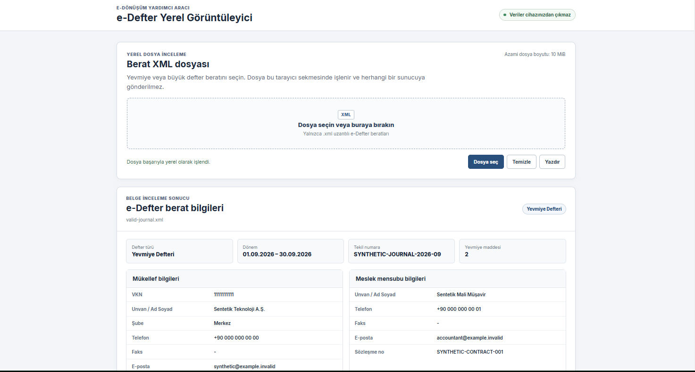
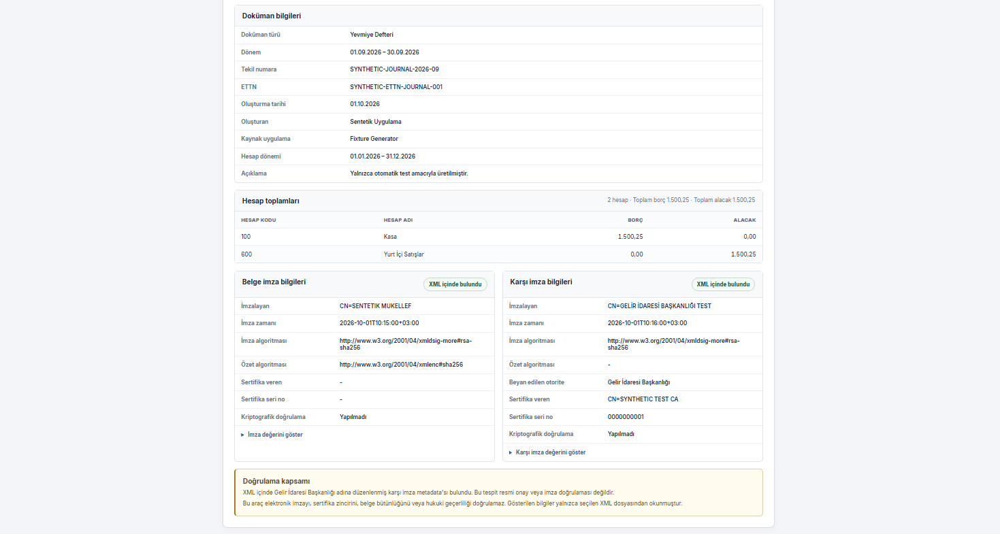

# e-Defter Yerel Görüntüleyici

[](https://github.com/Ekrem-Gungor/edefter-local-viewer/actions/workflows/ci.yml)
[](LICENSE)

Yevmiye ve büyük defter XML dosyalarını, beratları ve ZIP arşivlerini herhangi
bir sunucuya yüklemeden tarayıcı içinde inceleyen çevrimdışı araçtır.

## Kullanım

1. [Releases](https://github.com/Ekrem-Gungor/edefter-local-viewer/releases)
   sayfasından `EDEFTER_GORUNTULE.html` dosyasını indirin.
2. Güncel Microsoft Edge, Google Chrome veya Firefox ile açın.
3. Bir veya birden fazla `.xml` / `.zip` dosyası seçin ya da sürükleyin.
4. Soldaki listeden belgeyi seçin; hareketleri arayın, CSV indirin veya yazdırın.

Kurulum, internet bağlantısı, kullanıcı hesabı, sunucu veya veritabanı gerekmez.
Node.js yalnızca geliştiricilerin test ve build alması için gereklidir.

## Özellikler

- Yevmiye (Y), büyük defter (K), yevmiye beratı (YB), büyük defter beratı (KB).
- `edefter:defter`, `edefter:berat` ve doğrudan XBRL yapıları.
- Belge türünün dosya adı yerine XML içeriğinden belirlenmesi.
- Mükellef, meslek mensubu, belge ve dönem bilgileri.
- Hesap bazında borç/alacak toplamları ve hareket satırları.
- Berat özet toplamları ile tam defter hareketlerinin ayrı açıklanması.
- Çoklu dosya ve ZIP içindeki klasörlerden XML yükleme.
- Türkçe arama, 60 satırlık sayfalama, tüm hareketleri içeren CSV.
- Arama ve sayfalamadan bağımsız olarak seçili belgenin tüm hareketlerini yazdırma.
- Aynı adlı dosyada aynı içerik varsa atlama, içerik değişmişse mevcut belgeyi güncelleme.
- Kaynak XML önizlemesi ve özgün XML baytlarını değiştirmeden indirme.
- Belge imzası, karşı imza ve varsa ayrı defter imza değeri bilgileri.
- Tek HTML dosyasında çevrimdışı dağıtım.

## v1.0.0 ekran görüntüleri




Görüntüler önceki arayüze aittir ve sentetik test verileriyle hazırlanmıştır.
v1.1.0 belge listesi, hareket tablosu ve dışa aktarma kontrolleri ekler.

## Sınırlar

| Sınır                                             | Değer               |
| ------------------------------------------------- | ------------------- |
| XML dosyası                                       | 100 MiB             |
| ZIP arşivi                                        | 150 MiB             |
| Yüklenen toplam XML verisi                        | 300 MiB             |
| Oturumdaki belge sayısı / bir ZIP'teki XML sayısı | 500                 |
| Kaynak XML önizlemesi                             | İlk 80.000 karakter |

UTF-8 kodlaması desteklenir. ZIP içindeki XML dosyaları sırayla açılır;
açılmış gerçek veri boyutu da sınırlandırılır. Hatalı dosyalar ayrı listelenir,
diğer belgeler işlenmeye devam eder. İç içe ZIP arşivleri açılmaz.

Aynı ad ve ZIP yolu yeniden yüklendiğinde son geçerli içerik kullanılır.
Geçersiz bir güncelleme önceki belgeyi silmez. Farklı ZIP klasörlerindeki aynı
adlı belgeler ayrı tutulur.

Büyük belgelerin ayrıştırılması, arama veya tüm hareketlerin yazdırmaya
hazırlanması cihazın işlemci ve belleğine bağlı olarak zaman alabilir.

CSV aramadan bağımsız olarak seçili belgenin tüm hareketlerini içerir;
UTF-8 BOM, noktalı virgül ayırıcı ve noktalı ondalık biçimi kullanır.

## Gizlilik ve doğrulama kapsamı

- Dosyalar cihaz dışına gönderilmez; harici API, analiz veya izleme servisi yoktur.
- ZIP kütüphanesi HTML içine gömülüdür; CDN veya internet erişimi gerekmez.
- DTD ve entity bildirimleri reddedilir, XML kökü ve belge türü kontrol edilir.
- XML kaynaklı metinler güvenli DOM API'leriyle gösterilir.
- Gerçek müşteri belgeleri depoya, issue'lara veya ekran görüntülerine eklenmemelidir.

Araç elektronik imzayı, sertifika zincirini, zaman damgasını, belge bütünlüğünü
veya hukuki geçerliliği doğrulamaz. GİB adına karşı imza bilgisi bulunması bir
onay sonucu değildir. Tam XML şema doğrulaması yapılmaz.

## Geliştirme

Node.js **22.22.2 veya üzeri** kullanın.

```bash
npm ci
npm run test:coverage
npm run build
```

Geliştirme: `npm run dev`. Production çıktısı: `dist/EDEFTER_GORUNTULE.html`.

## Proje yapısı

| Dizin        | Sorumluluk                                            |
| ------------ | ----------------------------------------------------- |
| `src/xml`    | XML güvenlik, kök ve belge türü kontrolleri           |
| `src/parser` | Taraflar, hareketler, hesaplar ve imza bilgileri      |
| `src/import` | Çoklu XML/ZIP okuma, boyut sınırları ve güncelleme    |
| `src/ui`     | Güvenli DOM işlemleriyle rapor ve hareket tablosu     |
| `src/app`    | Seçim, arama, sayfalama ve yazdırma yaşam döngüsü     |
| `src/export` | CSV ve özgün XML indirme                              |
| `scripts`    | Tek dosyalık build                                    |
| `tests`      | Sentetik XML, ZIP, uygulama, arayüz ve build testleri |

## Dokümantasyon

- [Mimari](docs/architecture.md)
- [Ürün kapsamı](docs/product-scope.md)
- [v1.1.0 sürüm notları](docs/release-notes-v1.1.0.md)
- [Yayın kontrol listesi](docs/release-checklist.md)
- [Değişiklik günlüğü](CHANGELOG.md)
- [Güvenlik politikası](SECURITY.md)

v1.1.0 kaynak hazırlığı yeni sürüm içindir; GitHub Release yayını ayrı bir adımdır.
Proje [MIT Lisansı](LICENSE) ile sunulur. Gömülü ZIP bağımlılıklarının bildirimleri
[THIRD_PARTY_NOTICES.md](THIRD_PARTY_NOTICES.md) ve dağıtım HTML'sinde yer alır.
